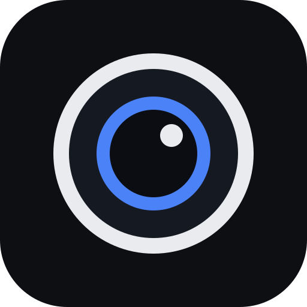
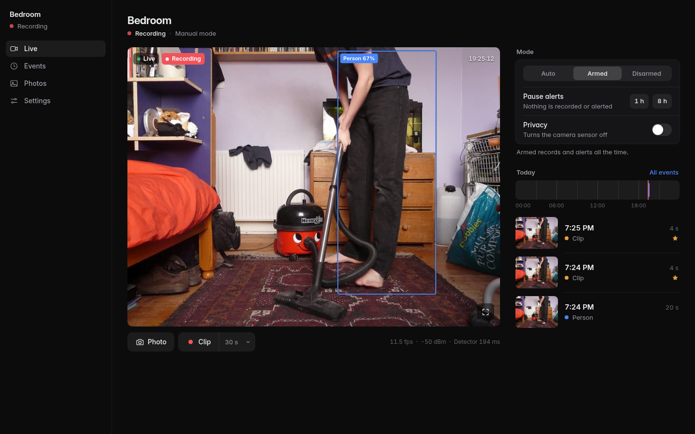
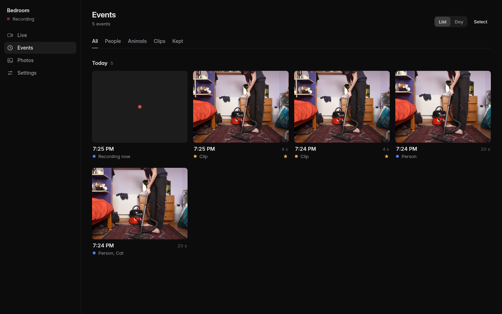
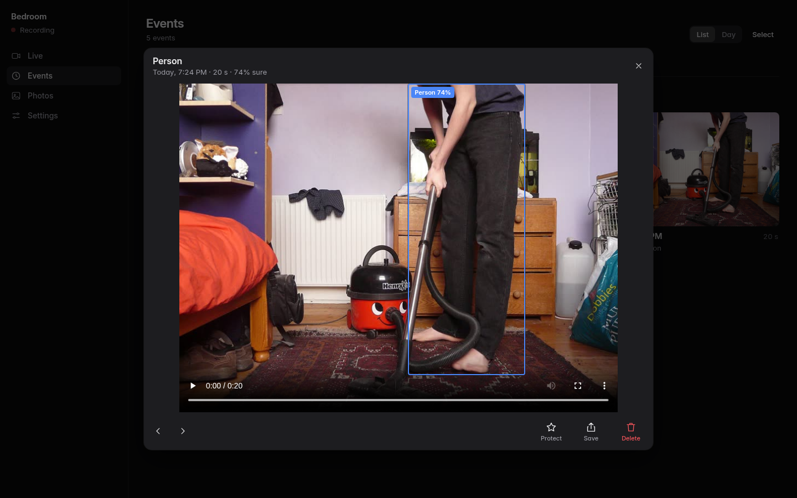
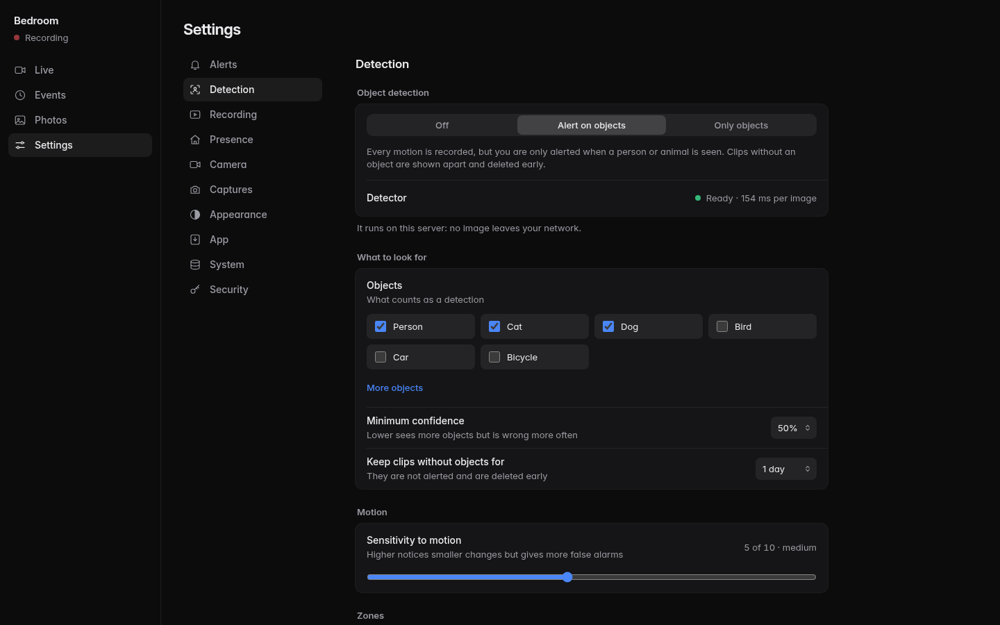
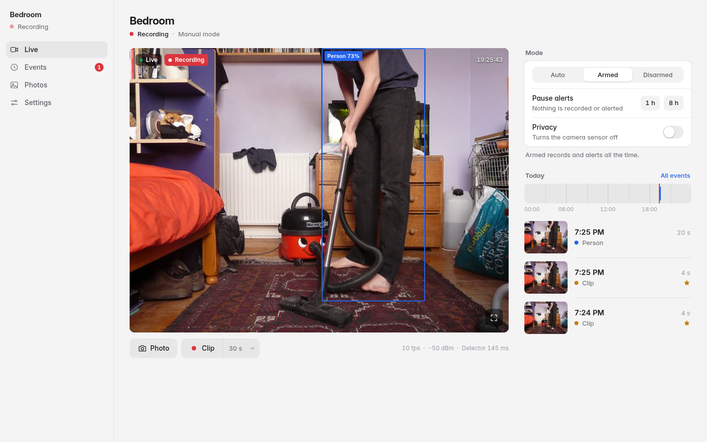
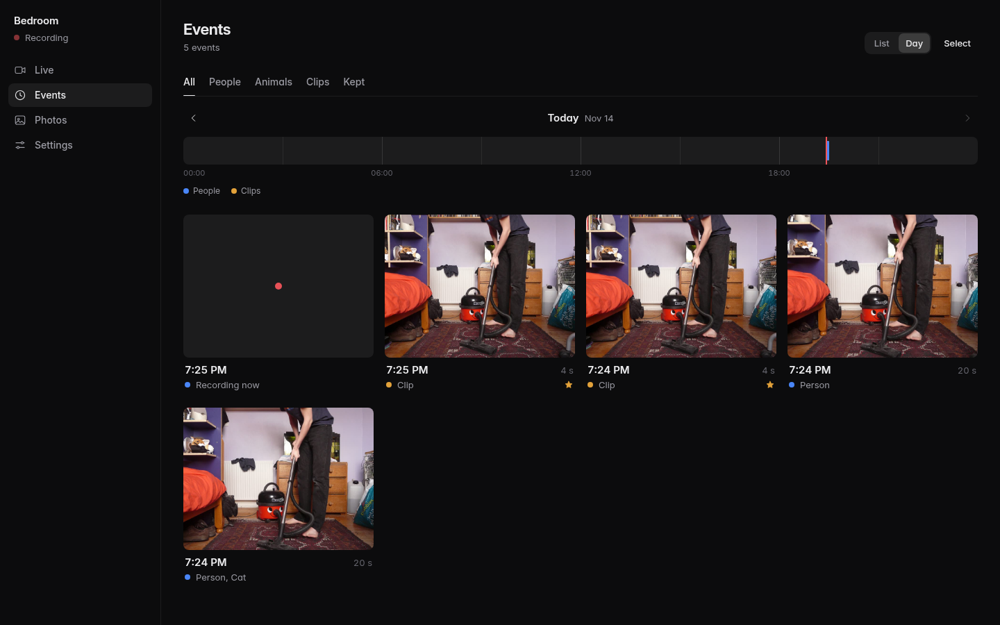
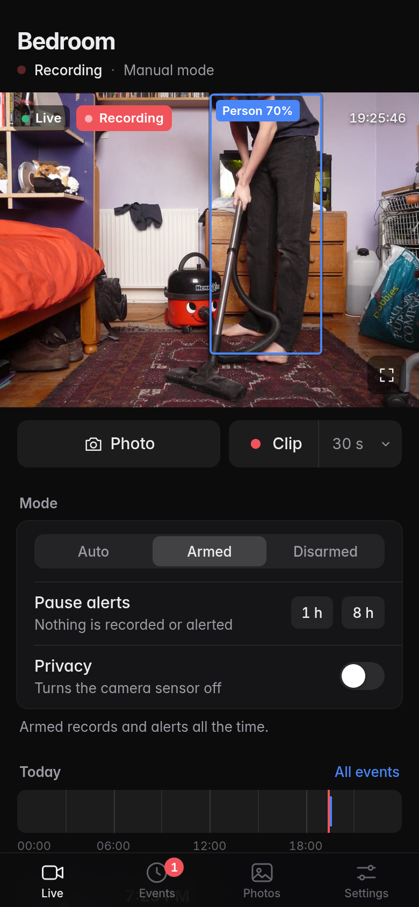
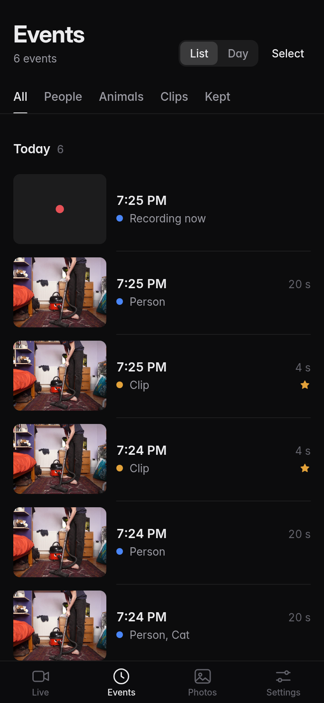
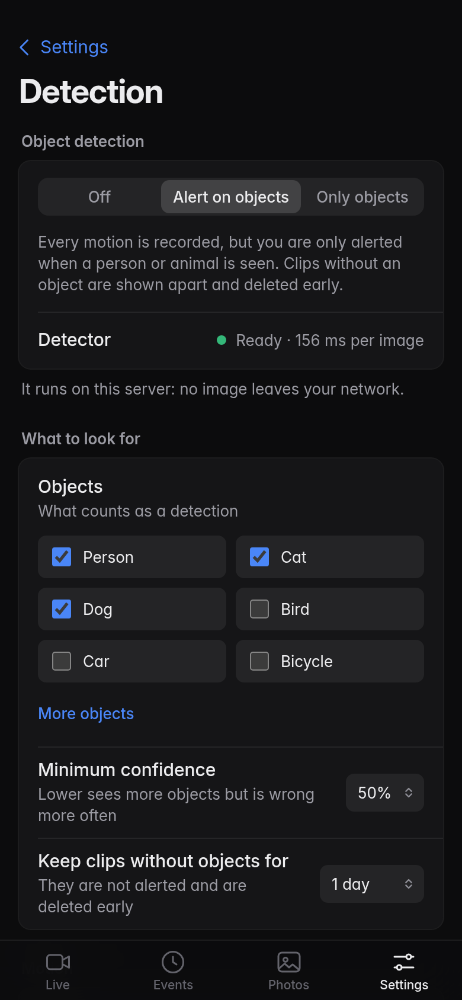

<div align="center">



# camd

**Una cámara autoalojada que distingue a las personas de las sombras.**

Una ESP32-CAM envía vídeo, un servidor pequeño en tu propia máquina reconoce personas y animales, graba clips y avisa a tu móvil. Un único binario estático, sin nube, sin suscripción y sin cuenta.

[](https://github.com/cristobaltormo/camd/actions/workflows/ci.yml)
[](https://github.com/cristobaltormo/camd/releases)
[](LICENSE)
[](https://www.rust-lang.org)

[Inicio rápido](#inicio-rápido) · [Documentación](#documentación) · [Instalar el firmware](https://cristobaltormo.github.io/camd/) · [FAQ](docs/faq.md) · [Changelog](CHANGELOG.md) · [English](README.md)

<br>



</div>

<br>

## Por qué

La mayoría de las cámaras con detección de movimiento avisan por cada sombra, cortina o cambio de luz hasta que dejas de mirar. camd usa el movimiento solo como primer filtro: una red neuronal pequeña revisa los fotogramas en los que algo se mueve y solo **las personas y los animales** generan un aviso. Funciona en la CPU del servidor, no necesita acelerador y el vídeo nunca sale de tu red.

- **Reconoce qué se ha movido.** [NanoDet](https://github.com/RangiLyu/nanodet) (3,8 MB, 80 clases de objetos) mira los fotogramas con movimiento. Tú eliges qué objetos importan. Mira [cómo funciona la detección](docs/detection.md).
- **Ligero.** Un binario estático con la aplicación web dentro. Unos 14 MB de memoria antes de necesitar el detector por primera vez y unos 40 MB con él cargado, sin crecer por mucho que dure un evento, y unos 27 ms por inferencia. Las grabaciones se escriben a disco mientras se hacen. Mira las [cifras](#recursos).
- **Una aplicación, no un panel.** Directo, eventos con el mejor fotograma y sus recuadros (en lista o en una línea de tiempo del día), fotos y clips manuales, como aplicación web progresiva que se instala en el móvil o el ordenador, en inglés y español, clara y oscura.
- **Avisos donde estés.** Web Push, [ntfy](https://ntfy.sh) y Notifich, con horas de silencio y un tiempo mínimo entre avisos.
- **Un servidor, varias cámaras.** Añade una tabla por cámara a la configuración; cada una guarda sus eventos y ajustes y la aplicación tiene un selector.
- **Sabe cuándo estás en casa.** Se arma sola cuando tu móvil sale de la wifi, y un interruptor de privacidad apaga el sensor de la cámara.
- **Seguro por defecto.** Passkeys o contraseña, sesiones revocables, protección CSRF y una política de seguridad de contenidos estricta. No se expone nada salvo que tú lo decidas. Mira [seguridad](docs/security.md).
- **Listo para Home Assistant.** El descubrimiento MQTT crea las entidades. Mira [Home Assistant](docs/home-assistant.md).
- **Fácil de flashear.** El firmware abre una página de configuración en el primer arranque: sin código y sin consola serie. Las actualizaciones van por wifi.

## Capturas

<table>
  <tr>
    <td width="50%"></td>
    <td width="50%"></td>
  </tr>
  <tr>
    <td></td>
    <td></td>
  </tr>
  <tr>
    <td colspan="2"></td>
  </tr>
</table>

<p align="center">
  
  
  
</p>

Las capturas salen del servidor real alimentado por una cámara falsa que reproduce una fotografía real, con una detección real del mismo modelo que usa el servidor. El crédito de la foto está en [docs/images/CREDITS.md](docs/images/CREDITS.md).

## Cómo encaja todo

```
ESP32-CAM  --MJPEG por wifi, token bearer-->  camd (tu servidor)
                                                |- movimiento: sustracción de fondo en fotogramas grises pequeños
                                                |- objetos: NanoDet, solo en fotogramas con movimiento
                                                |- eventos: pre-grabación + clip (ffmpeg) + miniatura, SQLite
                                                |- avisos: Web Push, ntfy, Notifich, MQTT
                                                `- aplicación web + API (passkeys o contraseña)
```

La cámara solo habla con el servidor. La ESP32 sirve el vídeo a un único cliente a la vez; el servidor lo lee una vez y lo reparte entre todos los que miran. Más en [arquitectura](docs/architecture.md).

## Comparación

camd hace una cosa: una ESP32-CAM (o unas pocas), un servidor pequeño y una buena aplicación. Los demás hacen mucho más y son la opción correcta para muchas cámaras o para cámaras RTSP.

| | camd | [Frigate](https://frigate.video) | [motionEye](https://github.com/motioneye-project/motioneye) | Cámara ESPHome + Home Assistant |
|---|---|---|---|---|
| Pensado para | placas ESP32-CAM | muchas cámaras IP (RTSP) | muchas cámaras | casa inteligente con una entidad de cámara |
| Detección de objetos | incluida, en CPU | incluida, se recomienda acelerador | solo movimiento | no incluida |
| Firmware para la cámara | incluido, con página de configuración y OTA | no | no | ESPHome |
| Necesita Home Assistant | no, opcional | no, opcional | no | sí |
| Qué instalas | un binario y FFmpeg, o un contenedor | un contenedor | un contenedor o paquetes de Python | Home Assistant |

## Qué necesitas

- Una **ESP32-CAM** (AI-Thinker, con PSRAM) y la placa base ESP32-CAM-MB o un programador USB, en una wifi de 2,4 GHz. Mira [hardware](docs/hardware.md).
- Una máquina siempre encendida: una Raspberry Pi 3 o posterior con sistema de 64 bits, un mini PC, un NAS, un contenedor de Proxmox, cualquier Linux, x86-64 o ARM64. El servidor usa unos 40 MB de memoria, más FFmpeg mientras codifica un clip. Docker es opcional.

## Inicio rápido

### 1. Flashea la cámara

Conecta la placa y abre el instalador web (Chrome o Edge): **https://cristobaltormo.github.io/camd/**. O compílalo tú con [PlatformIO](https://platformio.org): `cd firmware && pio run -t upload`.

### 2. Conéctala a tu wifi

Enciende la cámara. Crea una red wifi llamada `camd-setup-XXXX`. Únete desde el móvil; se abre una página donde eliges tu red, escribes su contraseña y copias el **token de acceso** que genera. La cámara se reinicia y entra en tu wifi. Más en [firmware](docs/firmware.md).

### 3. Arranca el servidor

En cualquier Linux con systemd (Debian, Ubuntu, Raspberry Pi OS y otros), con un solo comando:

```sh
curl -fsSL https://github.com/cristobaltormo/camd/releases/latest/download/install.sh | sudo bash
```

Descarga el binario para tu máquina, lo comprueba contra `SHA256SUMS`, instala FFmpeg, crea el usuario `camd`, `/etc/camd` y `/var/lib/camd`, y un servicio de systemd endurecido. Después sigue los cuatro pasos que imprime: el token de la cámara, `camera_host` y `origin`, una contraseña y `systemctl start camd`. El mismo comando actualiza una instalación existente, también una 2.x.

Con Docker:

```sh
git clone https://github.com/cristobaltormo/camd && cd camd
cp .env.example .env        # pon CAMD_CAMERA_HOST, CAMD_CAMERA_TOKEN y TZ
docker compose up -d
docker compose exec camd camd ctl password
```

La imagen es `ghcr.io/cristobaltormo/camd`, para `linux/amd64` y `linux/arm64`. A mano, desde una [release](https://github.com/cristobaltormo/camd/releases):

| Plataforma | Fichero |
|---|---|
| Linux x86-64 | `camd-linux-amd64` |
| Linux ARM64 (Raspberry Pi 3 y posteriores con sistema de 64 bits) | `camd-linux-arm64` |

```sh
f=camd-linux-amd64
curl -fLO https://github.com/cristobaltormo/camd/releases/latest/download/$f
curl -fLO https://github.com/cristobaltormo/camd/releases/latest/download/SHA256SUMS
grep " $f\$" SHA256SUMS | sha256sum -c
install -m 755 $f /usr/local/bin/camd
```

Los binarios son estáticos: no necesitan nada del sistema salvo `ffmpeg` (para los clips) y, para la presencia, `ping` y opcionalmente `arping`. Las instrucciones completas, compilar desde el código, HTTPS y un proxy inverso están en [instalación](docs/install.md).

### 4. Ábrelo

Ve a `http://SERVIDOR:8180`, entra con la contraseña que creaste y abre **Ajustes, Detección** para elegir qué buscar. Añade la página a la pantalla de inicio del móvil para recibir avisos.

Las passkeys necesitan HTTPS; [acceso remoto](docs/remote-access.md) explica tres formas de tenerlo, incluido un túnel gratuito de Cloudflare.

## Recursos

Medido en un contenedor Debian 13 con 2 vCPU de un Ryzen 7 7730U, con vídeo de 800x600 a 10 fps y la detección activada, frente al servidor 2.2 (Python) en la misma máquina y con el mismo vídeo:

| | 3.0 | 2.2 |
|---|---|---|
| Memoria recién arrancado, sin el detector cargado | 13,6 MB | |
| Memoria con la habitación en calma, detector cargado | 36,8 MB | 131,3 MB |
| Memoria tras 10 minutos de movimiento continuo | 40,2 MB, estable | 157,9 MB |
| CPU, habitación en calma | 4,0 % de un núcleo | 9,3 % |
| CPU, movimiento continuo con detección y clips | 11,1 % | 17,6 % |
| Análisis de movimiento por fotograma | 3,7 ms | 9,1 ms |
| Detección de objetos | unos 27 ms por imagen | unos 33 ms por imagen |
| Hilos | 7 | 13 |
| Del arranque a responder HTTP | 35 ms | 923 ms |
| Parada con alguien mirando el directo | 0,03 s | 5,2 s |

La detección se ejecuta como mucho cada 0,7 s y solo mientras algo se mueve; el modelo se carga la primera vez que hace falta y se libera de la memoria al desactivar la detección. El disco depende de la escena: la retención en días y un tope de tamaño los pones tú, y los clips más antiguos se van primero. Baja la resolución en **Ajustes, Cámara** para gastar aún menos CPU y wifi.

## Comandos

| | |
|---|---|
| `camd` | el servidor (`camd serve` es lo mismo) |
| `camd ctl password` | pone la contraseña de acceso |
| `camd ctl enroll` | imprime un código de diez minutos para registrar una passkey |
| `camd ctl devices` | lista las passkeys, la contraseña y las sesiones |
| `camd ctl revoke-all` | cierra todas las sesiones |
| `camd --version` | imprime la versión |

`camd-ctl` se acepta como nombre de `camd ctl`, así que los scripts escritos para 2.x siguen funcionando a través de un enlace. Todos los comandos leen la misma configuración: `CAMD_CONFIG` y las variables `CAMD_*`.

## Documentación

La documentación está en inglés.

| | |
|---|---|
| [Instalación](docs/install.md) | el instalador, Docker, binarios de la release, desde el código, acceso, copias de seguridad |
| [Hardware](docs/hardware.md) | la placa, la alimentación, dónde ponerla, el servidor |
| [Firmware](docs/firmware.md) | flashear, la página de configuración, actualizaciones, consola serie, API de la cámara |
| [Configuración](docs/configuration.md) | cada ajuste y su variable `CAMD_*` |
| [Detección](docs/detection.md) | cómo se reconocen los objetos y cómo afinarla |
| [Acceso remoto](docs/remote-access.md) | HTTPS, un túnel, un proxy inverso |
| [Home Assistant](docs/home-assistant.md) | descubrimiento MQTT |
| [Seguridad](docs/security.md) | qué está protegido y qué deberías hacer tú |
| [Problemas](docs/troubleshooting.md) y [FAQ](docs/faq.md) | cuando algo no funciona |
| [Arquitectura](docs/architecture.md) y [API](docs/api.md) | cómo funciona por dentro, y la API HTTP |
| [Desarrollo](docs/development.md) | estructura, tests, convenciones, releases |

## Actualizar desde 2.x

La versión 3.0 es el mismo servidor reescrito en Rust. Las claves de configuración, los valores por defecto y las variables `CAMD_*`, el directorio de datos, la base de datos, las passkeys, la contraseña, las sesiones, las suscripciones push, la API HTTP, los temas MQTT y los textos de los avisos se quedan como estaban. Volver a ejecutar el instalador actualiza en el sitio:

```sh
curl -fsSL https://github.com/cristobaltormo/camd/releases/latest/download/install.sh | sudo bash
```

Para el servicio, guarda la unidad, `/etc/camd` y la base de datos en `/var/backups/camd/`, instala el binario y la unidad nueva, lo arranca de nuevo e imprime cómo volver atrás. El virtualenv de Python en `/opt/camd/venv` se queda donde está, y 2.x lee lo que escribe 3.0, así que volver atrás es restaurar la unidad antigua. Con Docker, `docker compose pull && docker compose up -d`; la imagen mantiene el mismo id de usuario, así que el volumen de datos no necesita cambios. Una cosa que revisar antes de actualizar: un ajuste con el tipo equivocado en el fichero TOML (un número entre comillas, por ejemplo) ahora detiene el servidor con un error claro en vez de aceptarse. La lista completa de cambios está en [CHANGELOG.md](CHANGELOG.md).

## Hoja de ruta

Ideas, no promesas, más o menos en el orden en que se quieren:

- Otras placas ESP32 (S3 y XIAO) en el firmware.
- Sonido desde un micrófono I2S.

Abre un issue para votar o para proponer otra cosa.

## Desarrollo

```sh
make test       # cargo fmt --check, clippy, cargo test y los tests de la interfaz
make ui         # tests de navegador contra el binario real y una cámara falsa
make build      # compilación release, copiada a ./camd
make release-local   # binarios estáticos para x86-64 y ARM64 y SHA256SUMS en dist/
```

Los tests nunca necesitan red ni cámara: el detector es falso y una cámara falsa reproduce ficheros JPEG. `make release-local` compila en cruzado con [cargo-zigbuild](https://github.com/rust-cross/cargo-zigbuild). Más en [desarrollo](docs/development.md).

Los informes de errores con el log y la versión del firmware son la contribución más útil. Mira [CONTRIBUTING](CONTRIBUTING.md) y el [código de conducta](CODE_OF_CONDUCT.md). Para avisar de una vulnerabilidad, lee la [política de seguridad](SECURITY.md).

## Créditos y licencia

MIT, mira [LICENSE](LICENSE). El detector de objetos es NanoDet-Plus del [OpenCV Zoo](https://github.com/opencv/opencv_zoo) (Apache-2.0), que se descarga y verifica en el primer uso y se ejecuta con [tract](https://github.com/sonos/tract). La fuente de la interfaz es [Inter](https://rsms.me/inter/) (SIL OFL, incluida). Las ideas de la pre-grabación, las zonas y los filtros de objetos vienen de proyectos como Frigate, motionEye y ESPHome. La fotografía de las capturas es de Emilia Murray, CC BY-SA 2.0.
