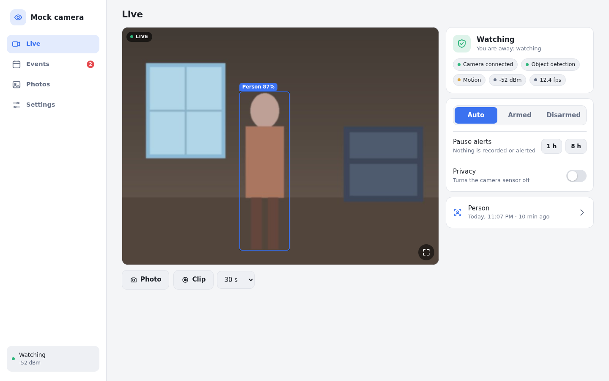

# camd

A small, self-hosted camera for one room: an **ESP32-CAM** streams video, a tiny server on your own machine **recognises people and animals**, records clips and alerts your phone. No cloud, no subscription, no account.

<p align="center">
  
</p>
<p align="center">
  
  
  
</p>

## What it does

- **Tells a person from a shadow.** Motion detection is only the first filter: a small neural network ([NanoDet](https://github.com/RangiLyu/nanodet), 3.8 MB, runs on the server's CPU) checks the moving frames and only people and animals raise an alert. Light changes, curtains and insects do not. See [how detection works](docs/detection.md).
- **Light on resources.** Frames are decoded at quarter size for motion, the network only runs while something moves (about 50 ms per image on two vCPUs), and recordings go to disk while they are made, so memory stays flat however long an event lasts. See [numbers](#resources).
- **Live view, events, photos, manual clips.** A progressive web app that installs on a phone or a desktop, in English and Spanish.
- **Alerts where you are.** Web Push and [ntfy](https://ntfy.sh) (plus Notifich), quiet hours and a cooldown between alerts.
- **Knows when you are home.** Arms itself when your phone leaves the wifi, with a privacy switch that turns the camera sensor off.
- **Secure by default.** Passkeys or a password, revocable sessions, CSRF protection, a strict content security policy, nothing exposed except what you decide to. See [security](docs/security.md).
- **Home Assistant ready.** Entities appear through MQTT discovery. See [Home Assistant](docs/home-assistant.md).
- **Easy to flash and set up.** The firmware opens a setup page the first time, so no code or serial console is needed. Updates go over wifi.

## How it fits together

```
ESP32-CAM  --MJPEG over wifi, bearer token-->  camd (your server)
                                                 |- motion: background subtraction on small gray frames
                                                 |- objects: NanoDet, only on frames with motion
                                                 |- events: pre-roll + clip (ffmpeg) + thumbnail, SQLite
                                                 |- alerts: Web Push, ntfy, Notifich, MQTT
                                                 `- web app + API (passkeys or password)
```

The camera only talks to the server, so the video of your room never needs to leave your network. The ESP32 can serve one stream client at a time; the server reads it once and shares it with every viewer.

## What you need

- An **ESP32-CAM** (AI-Thinker, with PSRAM) and a USB programmer or the ESP32-CAM-MB base board. A 2.4 GHz wifi network.
- A machine that is always on: a Raspberry Pi 4/5, a mini PC, a NAS, a Proxmox container, any Linux box with 1 GB of RAM. Docker is optional.

## Quick start

### 1. Flash the camera

Plug the board in and open the web installer (needs Chrome or Edge): **https://YOUR-USER.github.io/camd/** once the release workflow has run on your fork. Or build it yourself:

```bash
cd firmware
pip install platformio
pio run -t upload
```

### 2. Connect it to your wifi

Power the camera. It creates a wifi network called `camd-setup-XXXX`. Join it with your phone; a page opens where you pick your network, type its password and copy the **access token** it generates. The camera restarts and joins your wifi. More in [firmware](docs/firmware.md).

### 3. Run the server

With Docker:

```bash
cp .env.example .env        # set CAMD_CAMERA_HOST and CAMD_CAMERA_TOKEN
docker compose up -d --build
docker compose exec camd camd-ctl password
```

Without Docker, on Debian or Ubuntu:

```bash
sudo deploy/install.sh
```

then follow the four steps it prints. Full instructions, HTTPS and a reverse proxy are in [install](docs/install.md).

### 4. Open it

Go to `http://SERVER:8180`, sign in with the password you created and open **Settings, Detection** to choose what to look for. Add the page to your phone's home screen for alerts.

Passkeys need HTTPS; [remote access](docs/remote-access.md) shows three ways to get it, including a free Cloudflare Tunnel.

## Resources

Measured on a Debian 13 container with 2 vCPU of a Ryzen 7 7730U, an 800x600 stream at 10 fps, detection on, OpenCV from the pip wheel:

| | |
|---|---|
| Server memory | about 120 MB resident in a quiet room, about 150 MB during activity |
| CPU, quiet room | 3% of one core |
| CPU, activity | 5% of one core averaged over a minute that contains a light change and a walking person; short peaks while a clip is encoded |
| Object detection | about 50 ms per image, run at most every 0.7 s and only while something moves |
| Disk | depends on the scene. Retention (days) and a size cap are yours to set and the oldest clips go first |

Lower the resolution in **Settings, Camera** to cut CPU and wifi use further.

## Configuration

Everything has a default; override with `/etc/camd/config.toml` or `CAMD_*` environment variables. The full list is in [configuration](docs/configuration.md). Most behaviour (detection, recording, alerts, image) is also adjustable from the app and applies immediately.

## Development

```bash
cd server
pip install -e '.[dev]' opencv-python-headless
pytest                       # 100+ tests
node --test webtests/        # interface helpers and translations
python ../tools/fake_camera.py ./some-jpegs --token test      # a camera without hardware
```

[Development guide](docs/development.md), [contributing](CONTRIBUTING.md), [security policy](SECURITY.md), [changelog](CHANGELOG.md).

## Credits and license

MIT, see [LICENSE](LICENSE). The object detector is NanoDet-Plus from the [OpenCV Zoo](https://github.com/opencv/opencv_zoo) (Apache-2.0), downloaded and verified on first use. The interface and firmware are written from scratch; the ideas of pre-roll, zones and object filters come from projects such as Frigate, motionEye and ESPHome.
