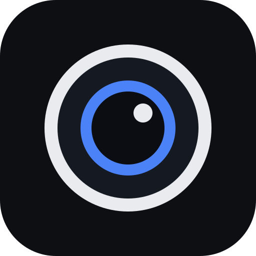
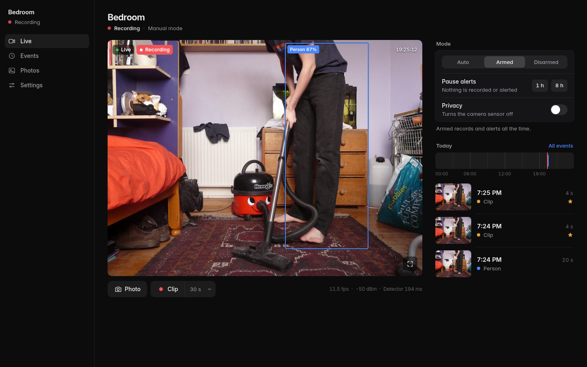
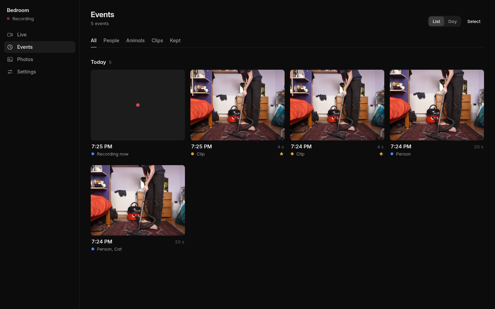
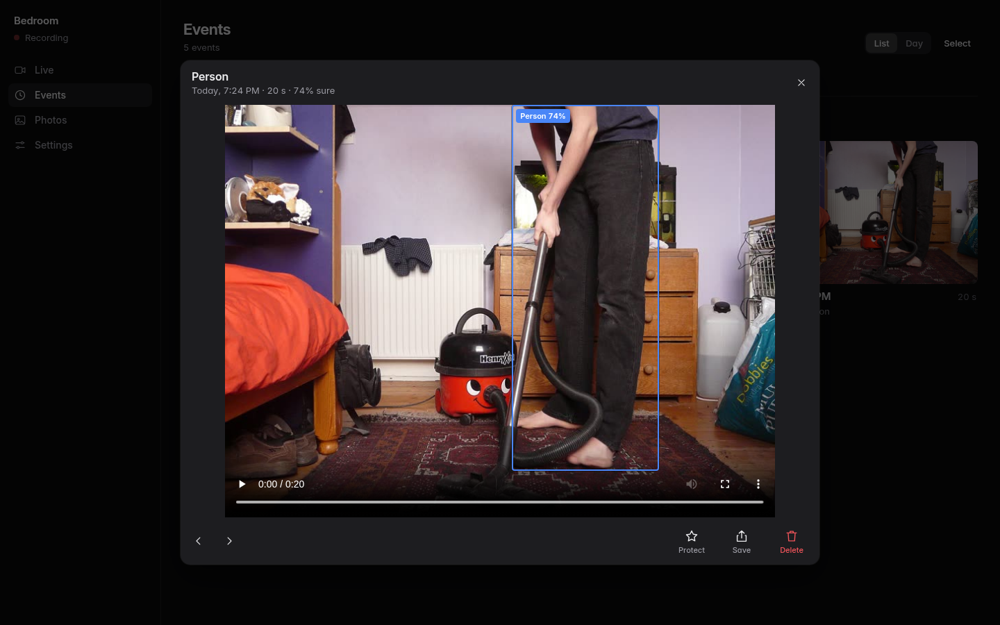
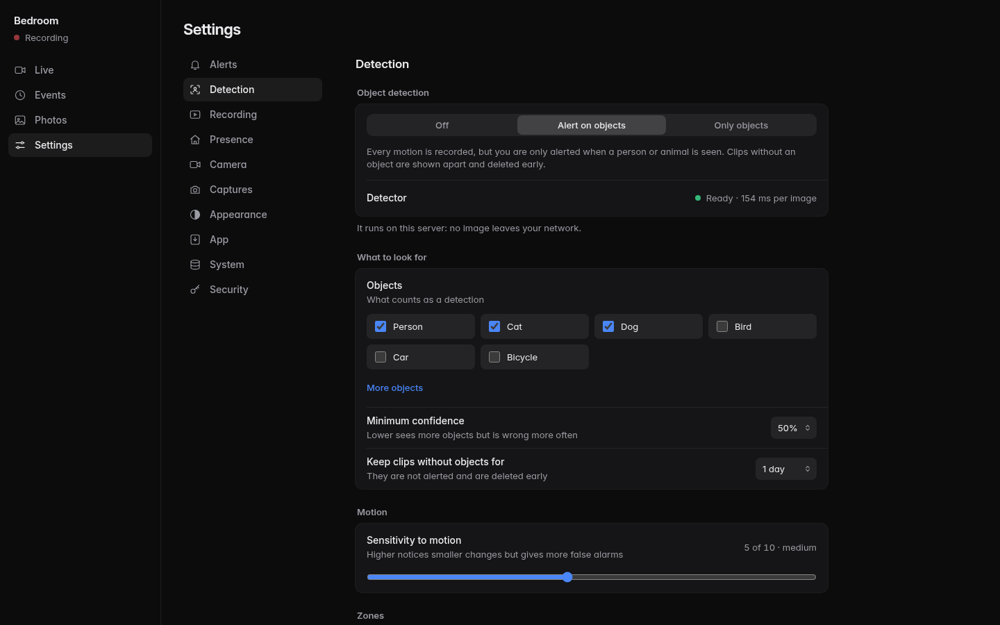
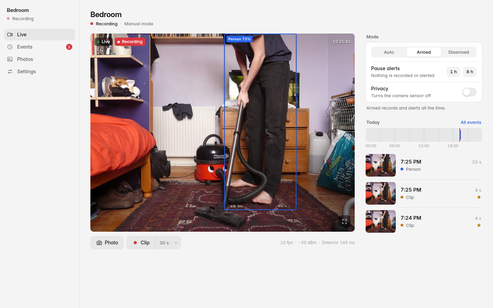
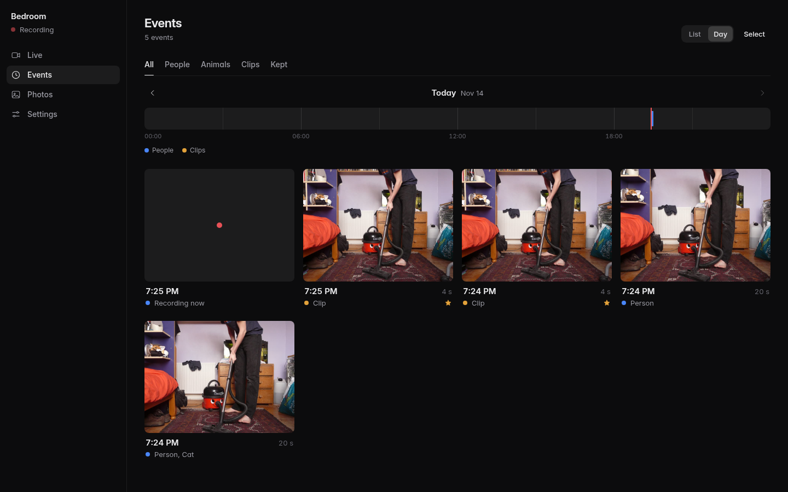
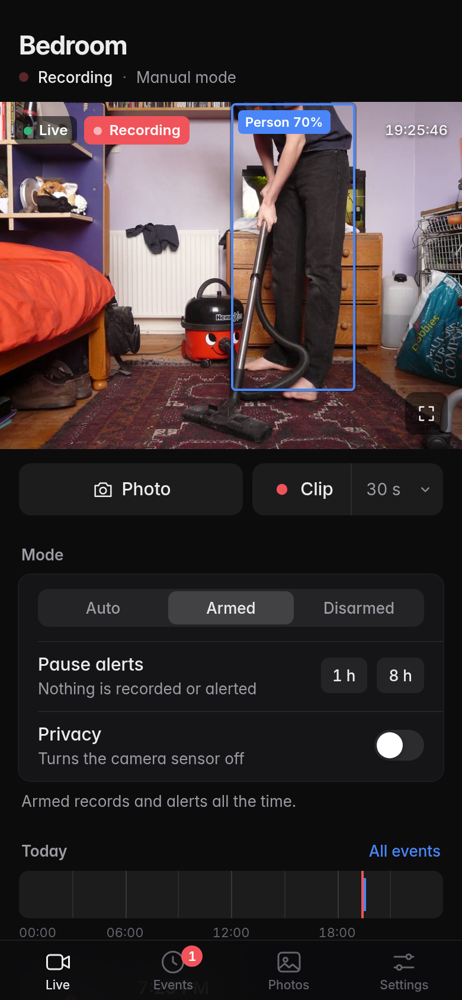
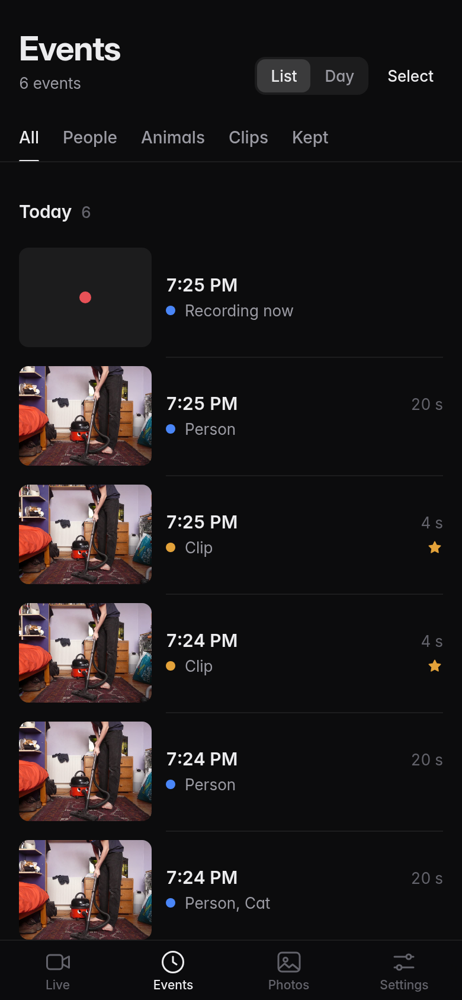
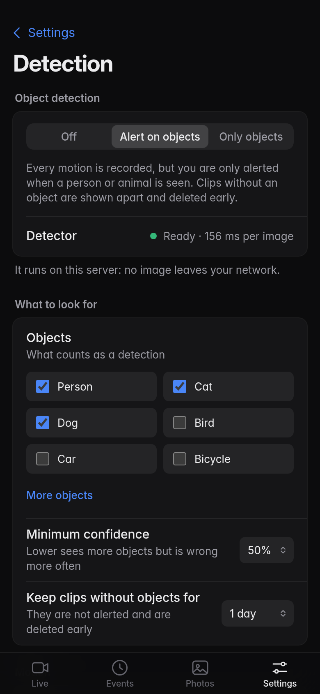

<div align="center">



# camd

**A self-hosted camera that tells people from shadows.**

An ESP32-CAM streams video, a small server on your own machine recognises people and animals, records clips and alerts your phone. One static binary, no cloud, no subscription, no account.

[](https://github.com/cristobaltormo/camd/actions/workflows/ci.yml)
[](https://github.com/cristobaltormo/camd/releases)
[](LICENSE)
[](https://www.rust-lang.org)

[Quick start](#quick-start) · [Documentation](#documentation) · [Install the firmware](https://cristobaltormo.github.io/camd/) · [FAQ](docs/faq.md) · [Changelog](CHANGELOG.md) · [Español](README.es.md)

<br>



</div>

<br>

## Why

Most motion cameras alert you for every shadow, curtain and change of light until you stop looking. camd treats motion as the first filter only: a small neural network checks the moving frames and only **people and animals** raise an alert. It runs on the server's CPU, needs no accelerator, and the video never leaves your network.

- **Recognises what moved.** [NanoDet](https://github.com/RangiLyu/nanodet) (3.8 MB, 80 object classes) looks at frames with motion. You pick which objects matter. See [how detection works](docs/detection.md).
- **Light.** One static binary with the web app inside. About 14 MB of memory before the detector is first needed and about 40 MB with it loaded, flat however long an event lasts, and about 27 ms per inference. Recordings go to disk while they are made. See the [numbers](#resources).
- **An app, not a dashboard.** Live view, events with the best frame and its boxes (as a list or on a timeline of the day), photos and manual clips, as a progressive web app that installs on a phone or desktop, in English and Spanish, light and dark.
- **Alerts where you are.** Web Push, [ntfy](https://ntfy.sh) and Notifich, with quiet hours and a cooldown between alerts.
- **One server, several cameras.** Add a table per camera to the configuration; each keeps its own events and settings and the app has a selector.
- **Knows when you are home.** It arms itself when your phone leaves the wifi, and a privacy switch turns the camera sensor off.
- **Secure by default.** Passkeys or a password, revocable sessions, CSRF protection and a strict content security policy. Nothing is exposed unless you decide to. See [security](docs/security.md).
- **Home Assistant ready.** MQTT discovery creates the entities. See [Home Assistant](docs/home-assistant.md).
- **Easy to flash.** The firmware opens a setup page on first boot: no code and no serial console. Updates go over wifi.

## Screenshots

<table>
  <tr>
    <td width="50%"></td>
    <td width="50%"></td>
  </tr>
  <tr>
    <td></td>
    <td></td>
  </tr>
  <tr>
    <td colspan="2"></td>
  </tr>
</table>

<p align="center">
  
  
  
</p>

The screenshots are taken from the real server fed by a fake camera that plays a real photograph, with a real detection by the model the server runs. Photo credit in [docs/images/CREDITS.md](docs/images/CREDITS.md).

## How it fits together

```
ESP32-CAM  --MJPEG over wifi, bearer token-->  camd (your server)
                                                 |- motion: background subtraction on small gray frames
                                                 |- objects: NanoDet, only on frames with motion
                                                 |- events: pre-roll + clip (ffmpeg) + thumbnail, SQLite
                                                 |- alerts: Web Push, ntfy, Notifich, MQTT
                                                 `- web app + API (passkeys or password)
```

The camera only talks to the server. The ESP32 serves one stream client at a time; the server reads it once and shares it with every viewer. More in [architecture](docs/architecture.md).

## How it compares

camd does one thing: one ESP32-CAM (or a few), one small server, a good app. The others do far more and are the right choice for many cameras or for RTSP hardware.

| | camd | [Frigate](https://frigate.video) | [motionEye](https://github.com/motioneye-project/motioneye) | ESPHome camera + Home Assistant |
|---|---|---|---|---|
| Built for | ESP32-CAM boards | many IP cameras (RTSP) | many cameras | smart home with a camera entity |
| Object detection | built in, CPU | built in, accelerator recommended | motion only | not built in |
| Firmware for the camera | included, with setup page and OTA | none | none | ESPHome |
| Needs Home Assistant | no, optional | no, optional | no | yes |
| What you install | one binary and FFmpeg, or one container | a container | a container or Python packages | Home Assistant |

## What you need

- An **ESP32-CAM** (AI-Thinker, with PSRAM) and the ESP32-CAM-MB base board or a USB programmer, on a 2.4 GHz wifi network. See [hardware](docs/hardware.md).
- A machine that is always on: a Raspberry Pi 3 or newer with a 64-bit system, a mini PC, a NAS, a Proxmox container, any Linux box, x86-64 or ARM64. The server itself uses about 40 MB of memory, plus FFmpeg while a clip is encoded. Docker is optional.

## Quick start

### 1. Flash the camera

Plug the board in and open the web installer (Chrome or Edge): **https://cristobaltormo.github.io/camd/**. Or build it yourself with [PlatformIO](https://platformio.org): `cd firmware && pio run -t upload`.

### 2. Connect it to your wifi

Power the camera. It creates a wifi network called `camd-setup-XXXX`. Join it with your phone; a page opens where you pick your network, type its password and copy the **access token** it generates. The camera restarts and joins your wifi. More in [firmware](docs/firmware.md).

### 3. Run the server

On any Linux with systemd (Debian, Ubuntu, Raspberry Pi OS and others), in one command:

```sh
curl -fsSL https://github.com/cristobaltormo/camd/releases/latest/download/install.sh | sudo bash
```

It downloads the binary for your machine, checks it against `SHA256SUMS`, installs FFmpeg, creates a `camd` user, `/etc/camd` and `/var/lib/camd`, and a hardened systemd service. Then follow the four steps it prints: the camera token, `camera_host` and `origin`, a password, and `systemctl start camd`. The same command upgrades an existing install, including a 2.x one.

With Docker:

```sh
git clone https://github.com/cristobaltormo/camd && cd camd
cp .env.example .env        # set CAMD_CAMERA_HOST, CAMD_CAMERA_TOKEN and TZ
docker compose up -d
docker compose exec camd camd ctl password
```

The image is `ghcr.io/cristobaltormo/camd`, for `linux/amd64` and `linux/arm64`. By hand, from a [release](https://github.com/cristobaltormo/camd/releases):

| Platform | File |
|---|---|
| Linux x86-64 | `camd-linux-amd64` |
| Linux ARM64 (Raspberry Pi 3 and later with a 64-bit system) | `camd-linux-arm64` |

```sh
f=camd-linux-amd64
curl -fLO https://github.com/cristobaltormo/camd/releases/latest/download/$f
curl -fLO https://github.com/cristobaltormo/camd/releases/latest/download/SHA256SUMS
grep " $f\$" SHA256SUMS | sha256sum -c
install -m 755 $f /usr/local/bin/camd
```

The binaries are static: they need nothing from the system except `ffmpeg` (for clips) and, for presence, `ping` and optionally `arping`. Full instructions, building from source, HTTPS and a reverse proxy are in [install](docs/install.md).

### 4. Open it

Go to `http://SERVER:8180`, sign in with the password you created and open **Settings, Detection** to choose what to look for. Add the page to your phone's home screen for alerts.

Passkeys need HTTPS; [remote access](docs/remote-access.md) shows three ways to get it, including a free Cloudflare Tunnel.

## Resources

Measured on a Debian 13 container with 2 vCPU of a Ryzen 7 7730U, with an 800x600 stream at 10 fps and detection on, against the 2.2 server (Python) on the same machine and stream:

| | 3.0 | 2.2 |
|---|---|---|
| Memory, fresh start, detector not loaded yet | 13.6 MB | |
| Memory, quiet room, detector loaded | 36.8 MB | 131.3 MB |
| Memory after 10 minutes of continuous motion | 40.2 MB, flat | 157.9 MB |
| CPU, quiet room | 4.0 % of one core | 9.3 % |
| CPU, continuous motion with detection and clips | 11.1 % | 17.6 % |
| Motion analysis per frame | 3.7 ms | 9.1 ms |
| Object detection | about 27 ms per image | about 33 ms per image |
| Threads | 7 | 13 |
| From start to answering HTTP | 35 ms | 923 ms |
| Stop with a viewer connected | 0.03 s | 5.2 s |

Detection runs at most every 0.7 s and only while something moves; the model is loaded the first time it is needed and dropped again when detection is turned off. Disk use depends on the scene: retention in days and a size cap are yours to set and the oldest clips go first. Lower the resolution in **Settings, Camera** to cut CPU and wifi use further.

## Commands

| | |
|---|---|
| `camd` | the server (`camd serve` is the same) |
| `camd ctl password` | set the sign-in password |
| `camd ctl enroll` | print a ten minute code to register a passkey |
| `camd ctl devices` | list passkeys, the password and sessions |
| `camd ctl revoke-all` | sign everyone out |
| `camd --version` | print the version |

`camd-ctl` is accepted as a name for `camd ctl`, so scripts written for 2.x keep working through a link. Every command reads the same configuration: `CAMD_CONFIG` and the `CAMD_*` variables.

## Documentation

| | |
|---|---|
| [Install](docs/install.md) | the installer, Docker, release binaries, from source, signing in, backups |
| [Hardware](docs/hardware.md) | the board, power, placement, the server |
| [Firmware](docs/firmware.md) | flashing, the setup page, updates, serial console, camera API |
| [Configuration](docs/configuration.md) | every setting and its `CAMD_*` variable |
| [Detection](docs/detection.md) | how objects are recognised and how to tune it |
| [Remote access](docs/remote-access.md) | HTTPS, a tunnel, a reverse proxy |
| [Home Assistant](docs/home-assistant.md) | MQTT discovery |
| [Security](docs/security.md) | what is protected and what you should do |
| [Troubleshooting](docs/troubleshooting.md) and [FAQ](docs/faq.md) | when something does not work |
| [Architecture](docs/architecture.md) and [API](docs/api.md) | how it works inside, and the HTTP API |
| [Development](docs/development.md) | layout, tests, conventions, releases |

## Upgrading from 2.x

Version 3.0 is the same server rewritten in Rust. Configuration keys, defaults and `CAMD_*` variables, the data directory, the database, passkeys, passwords, sessions, push subscriptions, the HTTP API, MQTT topics and alert texts stay as they were. Running the installer again upgrades in place:

```sh
curl -fsSL https://github.com/cristobaltormo/camd/releases/latest/download/install.sh | sudo bash
```

It stops the service, saves the unit, `/etc/camd` and the database to `/var/backups/camd/`, installs the binary and the new unit, starts it again and prints how to go back. The Python virtualenv in `/opt/camd/venv` is left in place, and 2.x reads what 3.0 writes, so going back is restoring the old unit. With Docker, `docker compose pull && docker compose up -d`; the image keeps the same user id, so the data volume needs no change. One thing to check before upgrading: a setting with the wrong type in the TOML file (a number in quotes, for example) now stops the server with a clear error instead of being accepted. The full list of changes is in [CHANGELOG.md](CHANGELOG.md).

## Roadmap

Ideas, not promises, roughly in the order they are wanted:

- Other ESP32 boards (S3 and XIAO) in the firmware.
- Sound from an I2S microphone.

Open an issue to vote or to suggest something else.

## Development

```sh
make test       # cargo fmt --check, clippy, cargo test and the interface tests
make ui         # browser tests against the real binary and a fake camera
make build      # release build, copied to ./camd
make release-local   # static binaries for x86-64 and ARM64 and SHA256SUMS in dist/
```

The tests never need the network or a camera: the detector is faked and a fake camera plays JPEG files. `make release-local` cross-compiles with [cargo-zigbuild](https://github.com/rust-cross/cargo-zigbuild). More in [development](docs/development.md).

Bug reports with the log and the firmware version are the most useful contribution. See [CONTRIBUTING](CONTRIBUTING.md) and the [code of conduct](CODE_OF_CONDUCT.md). To report a vulnerability, read the [security policy](SECURITY.md).

## Credits and license

MIT, see [LICENSE](LICENSE). The object detector is NanoDet-Plus from the [OpenCV Zoo](https://github.com/opencv/opencv_zoo) (Apache-2.0), downloaded and verified on first use and run with [tract](https://github.com/sonos/tract). The interface font is [Inter](https://rsms.me/inter/) (SIL OFL, bundled). The ideas of pre-roll, zones and object filters come from projects such as Frigate, motionEye and ESPHome. The photograph in the screenshots is by Emilia Murray, CC BY-SA 2.0.
