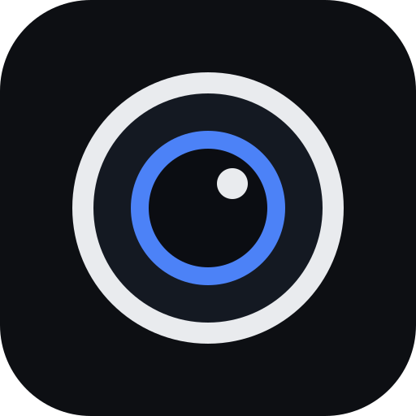
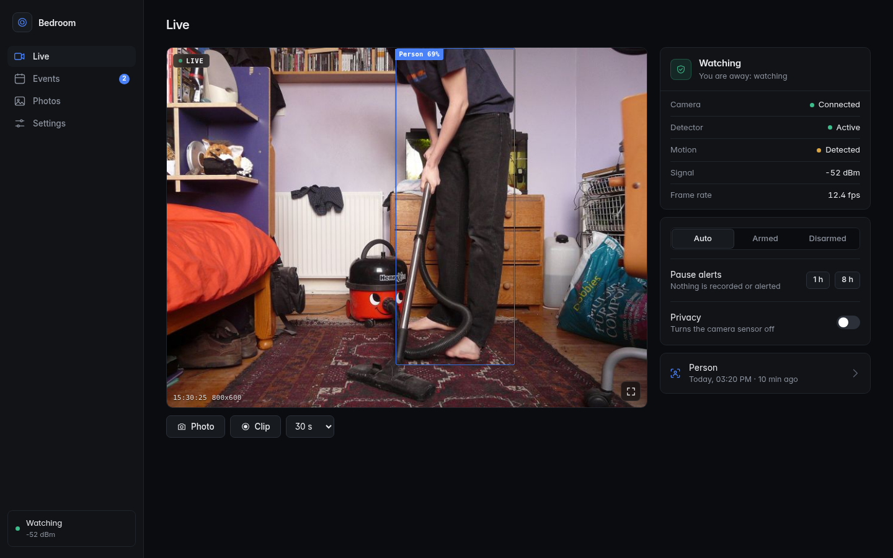
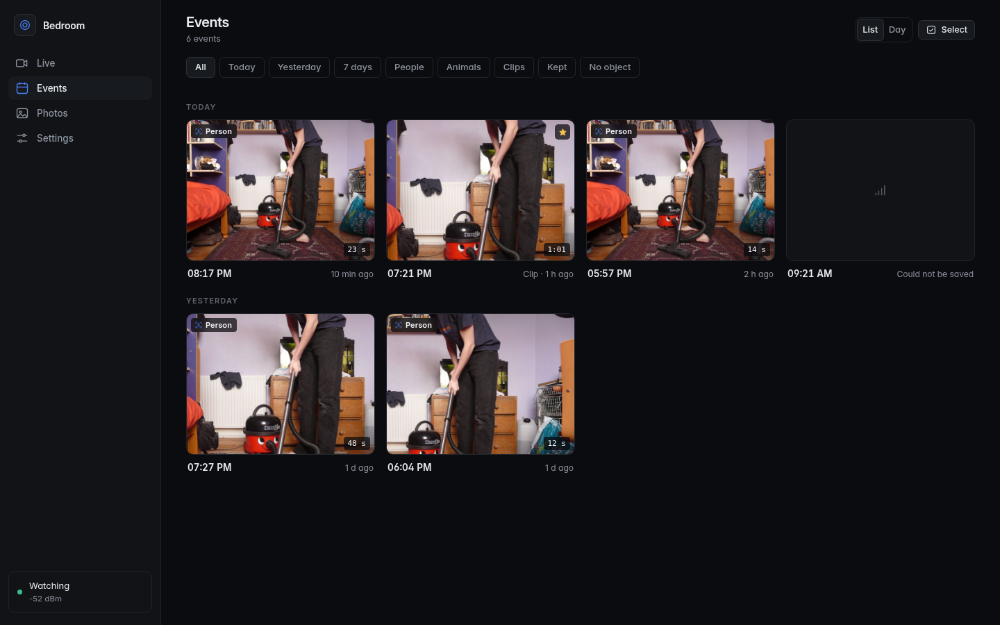
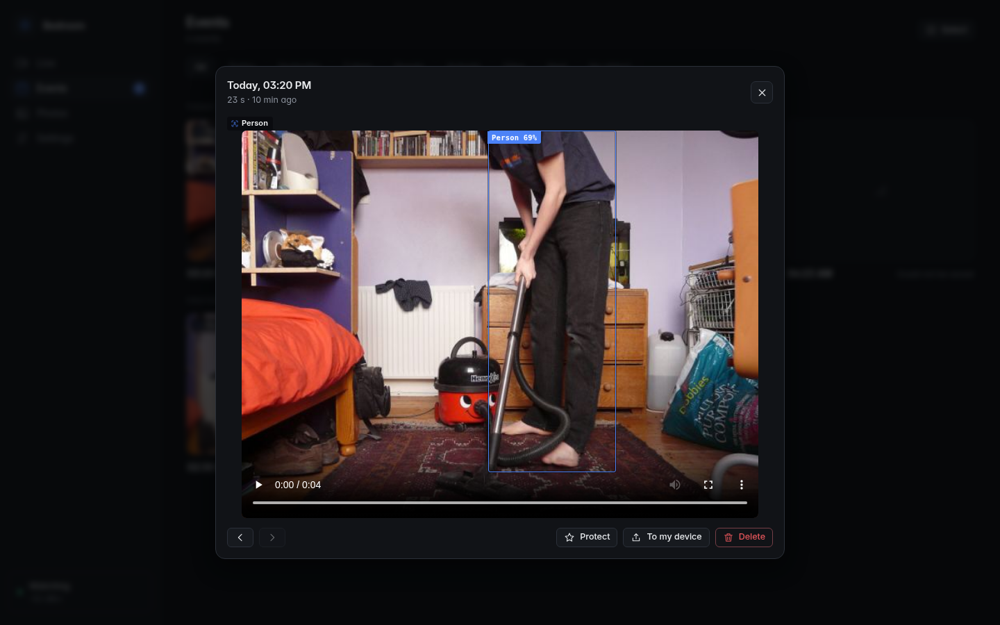
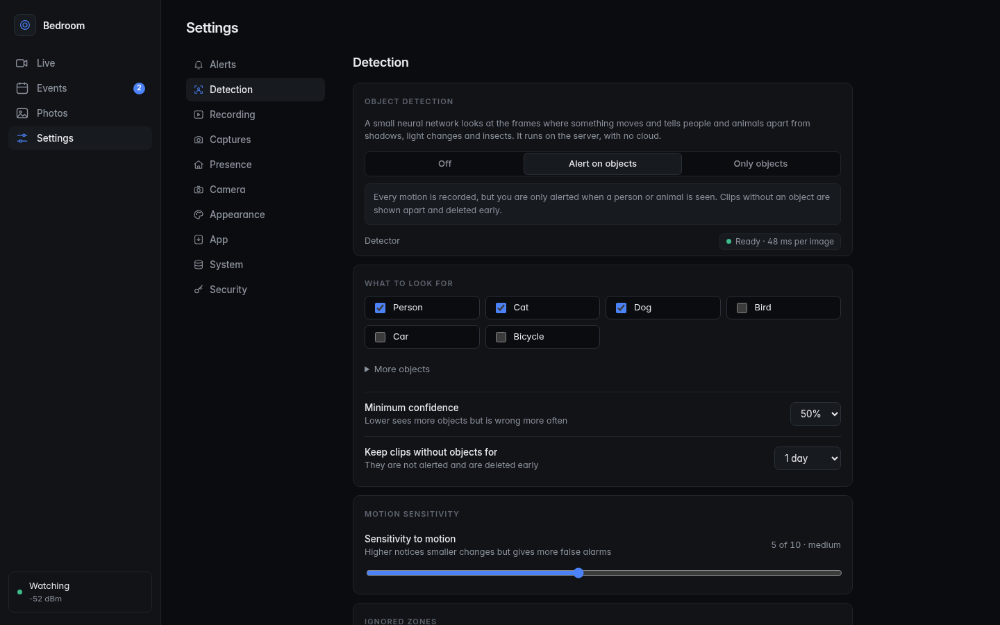
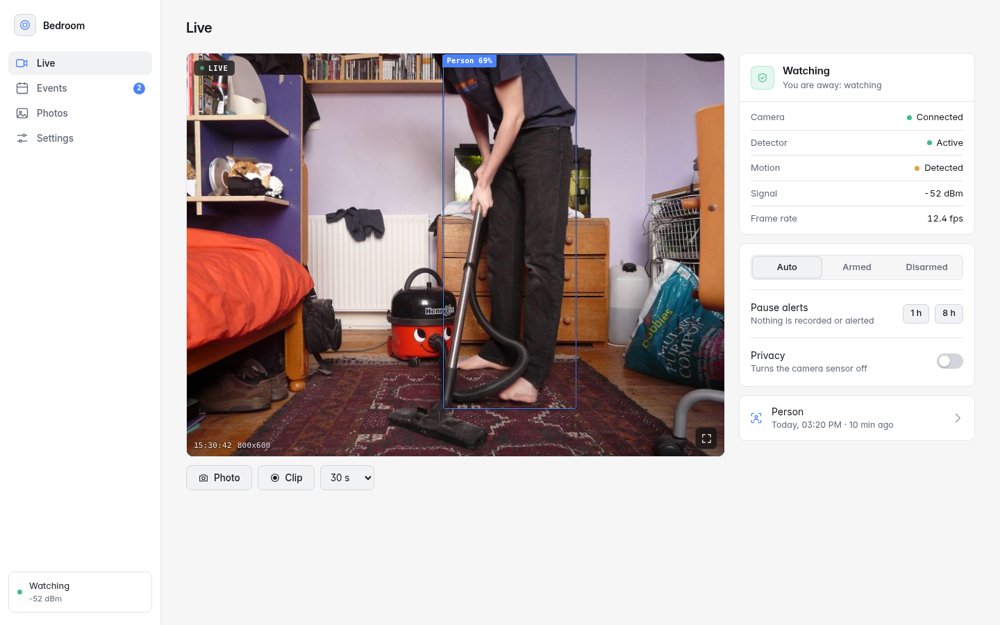
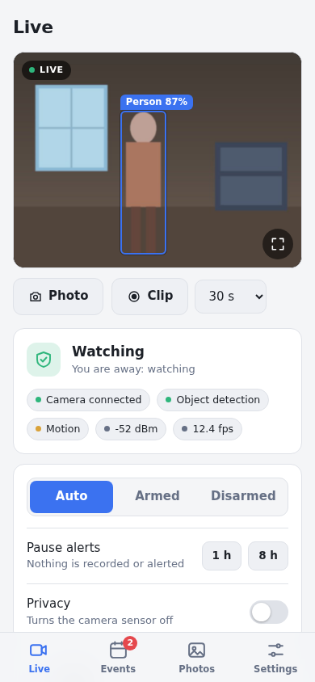
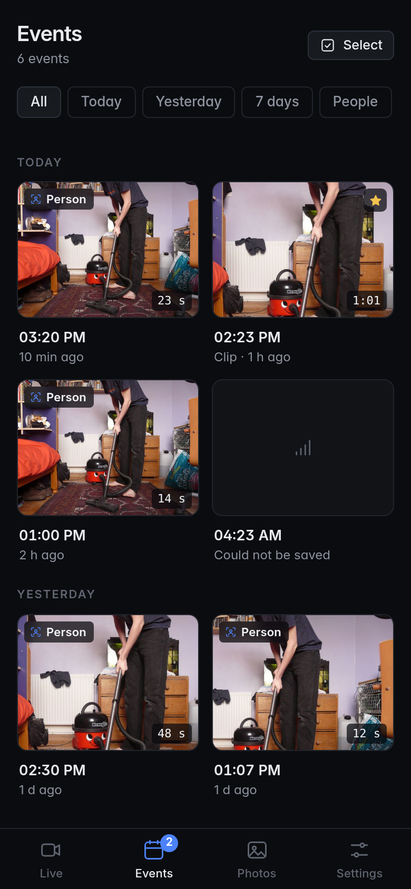
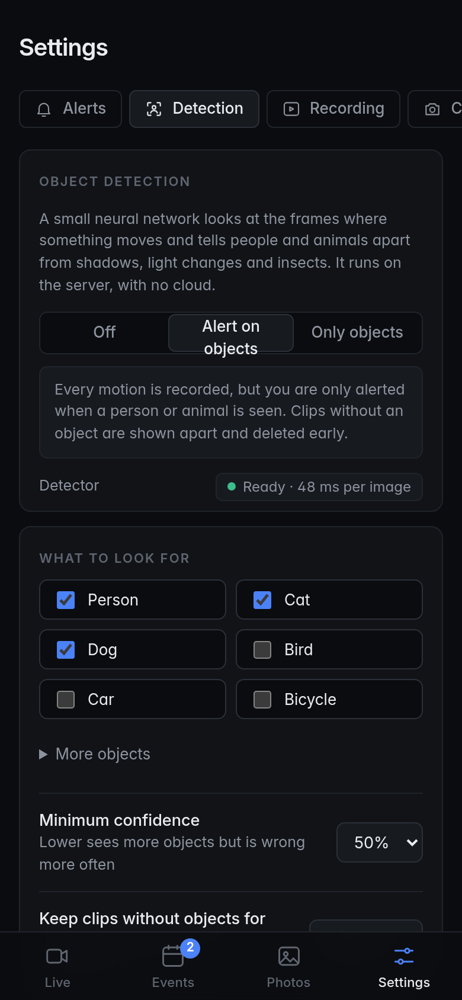

<div align="center">



# camd

**A self-hosted camera that tells people from shadows.**

An ESP32-CAM streams video, a small server on your own machine recognises people and animals, records clips and alerts your phone. No cloud, no subscription, no account.

[](https://github.com/cristobaltormo/camd/actions/workflows/ci.yml)
[](https://github.com/cristobaltormo/camd/releases)
[](LICENSE)


[Quick start](#quick-start) · [Documentation](#documentation) · [Install the firmware](https://cristobaltormo.github.io/camd/) · [Changelog](CHANGELOG.md)

<br>



</div>

<br>

## Why

Most motion cameras alert you for every shadow, curtain and change of light until you stop looking. camd treats motion as the first filter only: a small neural network checks the moving frames and only **people and animals** raise an alert. It runs on the server's CPU, needs no accelerator, and the video never leaves your network.

- **Recognises what moved.** [NanoDet](https://github.com/RangiLyu/nanodet) (3.8 MB, 80 object classes) looks at frames with motion. You pick which objects matter. See [how detection works](docs/detection.md).
- **Light on resources.** About 3% of one core in a quiet room, 120 to 150 MB of RAM, 50 ms per inference. Recordings go to disk while they are made, so memory stays flat however long an event lasts. See the [numbers](#resources).
- **An app, not a dashboard.** Live view, events with the best frame and its boxes, photos and manual clips, as a progressive web app that installs on a phone or desktop, in English and Spanish, light and dark.
- **Alerts where you are.** Web Push, [ntfy](https://ntfy.sh) and Notifich, with quiet hours and a cooldown between alerts.
- **Knows when you are home.** It arms itself when your phone leaves the wifi, and a privacy switch turns the camera sensor off.
- **Secure by default.** Passkeys or a password, revocable sessions, CSRF protection and a strict content security policy. Nothing is exposed unless you decide to. See [security](docs/security.md).
- **Home Assistant ready.** MQTT discovery creates the entities. See [Home Assistant](docs/home-assistant.md).
- **Easy to flash.** The firmware opens a setup page on first boot: no code and no serial console. Updates go over wifi.

## Screenshots

<table>
  <tr>
    <td width="50%"></td>
    <td width="50%"></td>
  </tr>
  <tr>
    <td></td>
    <td></td>
  </tr>
</table>

<p align="center">
  
  
  
</p>

The screenshots show the interface against a mock server with a real photograph, and a real detection by the same model the server runs. Photo credit in [docs/images/CREDITS.md](docs/images/CREDITS.md).

## How it fits together

```
ESP32-CAM  --MJPEG over wifi, bearer token-->  camd (your server)
                                                 |- motion: background subtraction on small gray frames
                                                 |- objects: NanoDet, only on frames with motion
                                                 |- events: pre-roll + clip (ffmpeg) + thumbnail, SQLite
                                                 |- alerts: Web Push, ntfy, Notifich, MQTT
                                                 `- web app + API (passkeys or password)
```

The camera only talks to the server. The ESP32 serves one stream client at a time; the server reads it once and shares it with every viewer. More in [architecture](docs/architecture.md).

## How it compares

camd does one thing: one ESP32-CAM, one small server, a good app. The others do far more and are the right choice for many cameras or for RTSP hardware.

| | camd | [Frigate](https://frigate.video) | [motionEye](https://github.com/motioneye-project/motioneye) | ESPHome camera + Home Assistant |
|---|---|---|---|---|
| Built for | one ESP32-CAM | many IP cameras (RTSP) | many cameras | smart home with a camera entity |
| Object detection | built in, CPU | built in, accelerator recommended | motion only | not built in |
| Firmware for the camera | included, with setup page and OTA | none | none | ESPHome |
| Needs Home Assistant | no, optional | no, optional | no | yes |

## What you need

- An **ESP32-CAM** (AI-Thinker, with PSRAM) and the ESP32-CAM-MB base board or a USB programmer, on a 2.4 GHz wifi network. See [hardware](docs/hardware.md).
- A machine that is always on: a Raspberry Pi 4 or 5, a mini PC, a NAS, a Proxmox container, any Linux box with 1 GB of RAM. x86-64 and ARM64. Docker is optional.

## Quick start

### 1. Flash the camera

Plug the board in and open the web installer (Chrome or Edge): **https://cristobaltormo.github.io/camd/**. Or build it yourself:

```bash
cd firmware
pip install platformio
pio run -t upload
```

### 2. Connect it to your wifi

Power the camera. It creates a wifi network called `camd-setup-XXXX`. Join it with your phone; a page opens where you pick your network, type its password and copy the **access token** it generates. The camera restarts and joins your wifi. More in [firmware](docs/firmware.md).

### 3. Run the server

With Docker:

```bash
git clone https://github.com/cristobaltormo/camd && cd camd
cp .env.example .env        # set CAMD_CAMERA_HOST and CAMD_CAMERA_TOKEN
docker compose up -d
docker compose exec camd camd-ctl password
```

Without Docker, on Debian or Ubuntu:

```bash
sudo deploy/install.sh
```

then follow the four steps it prints. Full instructions, HTTPS and a reverse proxy are in [install](docs/install.md).

### 4. Open it

Go to `http://SERVER:8180`, sign in with the password you created and open **Settings, Detection** to choose what to look for. Add the page to your phone's home screen for alerts.

Passkeys need HTTPS; [remote access](docs/remote-access.md) shows three ways to get it, including a free Cloudflare Tunnel.

## Resources

Measured on a Debian 13 container with 2 vCPU of a Ryzen 7 7730U, an 800x600 stream at 10 fps, detection on, OpenCV from the pip wheel:

| | |
|---|---|
| Server memory | about 120 MB resident in a quiet room, about 150 MB during activity |
| CPU, quiet room | 3% of one core |
| CPU, activity | 5% of one core averaged over a minute that contains a light change and a walking person; short peaks while a clip is encoded |
| Object detection | about 50 ms per image, run at most every 0.7 s and only while something moves |
| Disk | depends on the scene. Retention (days) and a size cap are yours to set and the oldest clips go first |

Lower the resolution in **Settings, Camera** to cut CPU and wifi use further.

## Documentation

| | |
|---|---|
| [Install](docs/install.md) | Docker, Debian and Ubuntu, signing in, first start, backups |
| [Hardware](docs/hardware.md) | the board, power, placement, the server |
| [Firmware](docs/firmware.md) | flashing, the setup page, updates, serial console, camera API |
| [Configuration](docs/configuration.md) | every setting and its `CAMD_*` variable |
| [Detection](docs/detection.md) | how objects are recognised and how to tune it |
| [Remote access](docs/remote-access.md) | HTTPS, a tunnel, a reverse proxy |
| [Home Assistant](docs/home-assistant.md) | MQTT discovery |
| [Security](docs/security.md) | what is protected and what you should do |
| [Troubleshooting](docs/troubleshooting.md) and [FAQ](docs/faq.md) | when something does not work |
| [Architecture](docs/architecture.md) and [API](docs/api.md) | how it works inside, and the HTTP API |
| [Development](docs/development.md) | layout, tests, conventions |

## Roadmap

Ideas, not promises, roughly in the order they are wanted:

- More than one camera on one server.
- Alert only for objects inside a drawn zone.
- A timeline to scrub through a day.
- Other ESP32 boards (S3 and XIAO) in the firmware.
- Sound from an I2S microphone.

Open an issue to vote or to suggest something else.

## Contributing

Bug reports with the log and the firmware version are the most useful contribution. See [CONTRIBUTING](CONTRIBUTING.md) and the [code of conduct](CODE_OF_CONDUCT.md). To report a vulnerability, read the [security policy](SECURITY.md).

```bash
make install        # server with development dependencies
make test lint web  # the checks CI runs
```

## Credits and license

MIT, see [LICENSE](LICENSE). The object detector is NanoDet-Plus from the [OpenCV Zoo](https://github.com/opencv/opencv_zoo) (Apache-2.0), downloaded and verified on first use. The interface font is [Inter](https://rsms.me/inter/) (SIL OFL, bundled). The ideas of pre-roll, zones and object filters come from projects such as Frigate, motionEye and ESPHome. The photograph in the screenshots is by Emilia Murray, CC BY-SA 2.0.
